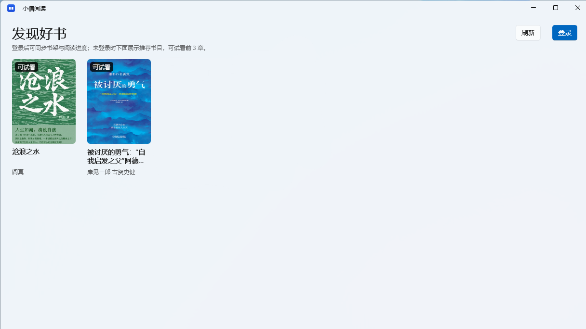
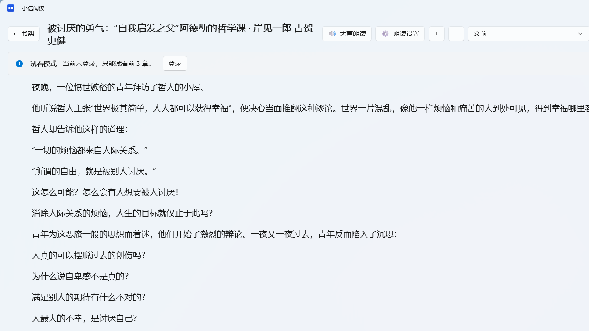
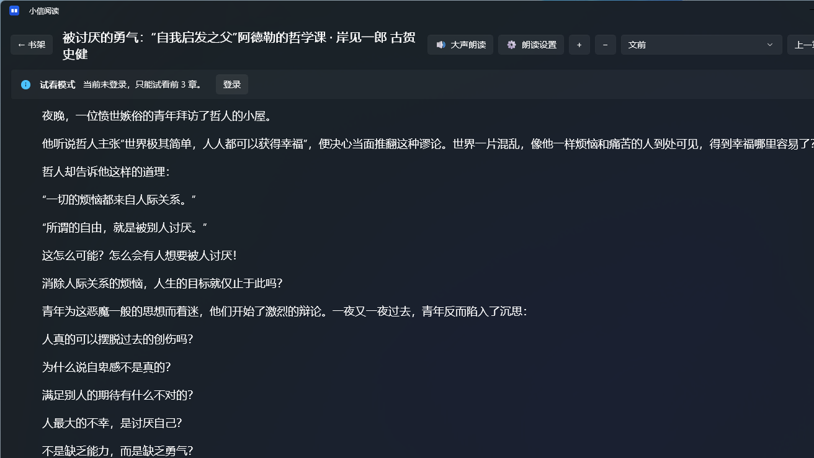

# 小信阅读（xinread）

WinUI 3 版微信读书客户端。登录、书架、目录、正文解析均为 C# 原生实现，
协议算法移植自 [weread-omni](https://github.com/teng-lin/weread-omni)，不依赖任何 Node 运行时。

- 目标框架：`.NET 11`（`net11.0-windows10.0.26100.0`）
- UI：Windows App SDK / WinUI 3，正文转 Markdown 后用原生 XAML 控件渲染，不依赖 WebView2
- 平台：x64 / ARM64

隐私政策：[中文](PRIVACY.md) · [English](PRIVACY.en.md)

## 截图

**书架（未登录）** — 展示官网推荐书目，每本标「可试看」，可直接试读前 3 章。



**阅读页** — 工具栏从左到右是朗读、朗读设置、字号、章节选择、翻章；同一章节在系统
浅色 / 深色下的效果：

| 浅色模式 | 深色模式 |
|---|---|
|  |  |

深色模式完全跟随 Windows 的系统设置，没有单独开关。

## 运行

```powershell
dotnet run -p:Platform=x64
```

WinUI 3 未打包启动需要包身份，必须带上 `-p:Platform=x64`（该参数会通过
`Microsoft.Windows.SDK.BuildTools.WinApp` 注册临时 AUMID 后再启动），否则会报
`REGDB_E_CLASSNOTREG`。

Release 构建：

```powershell
dotnet build -c Release -p:Platform=x64
```

> Release 下 `SelfContained=true`，但不做程序集裁剪——WinUI 3 不支持裁剪，详见
> [发布到 Microsoft Store](#发布到-microsoft-store) 里的说明。

## 图标

应用图标是**用代码画出来的矢量图形**，不依赖任何设计工具或外部素材：
蓝色圆角底板 + 白色对开书，全部坐标写在一张 100×100 的设计画布上，渲染时等比缩放。

```powershell
cd tools\IconGen
dotnet run                                     # 写入 Assets\ 下所有尺寸
dotnet run -- <目录>                            # 写到别的目录
dotnet run -- --preview <目录>                   # 额外输出放大预览，检查小尺寸可读性
```

生成器会一次性产出 `Package.appxmanifest` 引用的全部 PNG，以及含 16/24/32/48/64/128/256
七个尺寸的 `AppIcon.ico`。几个细节：

- **超采样**：先在 4–16 倍画布上绘制再缩小，边缘不会有锯齿。
- **小尺寸单独优化**：≤24px 时改用更窄的书页、更宽的留白和矩形轮廓，因为 16px 下
  书本只有十几个像素宽，柔和曲线会被抗锯齿抹平。
- **中缝按像素自适应**：中缝宽度取「不低于 1.5 物理像素」与设计比例中的较大值，
  否则小尺寸下两页会糊成一块白斑。

`tools/` 已被 `xinread.csproj` 排除，不会编进应用。

## 发布到 Microsoft Store

一条命令产出 x64 + ARM64 的多架构 bundle：

```powershell
.\pack-store.ps1                          # 版本取自 Package.appxmanifest
.\pack-store.ps1 -Version 1.0.1.0         # 覆盖版本号
```

产物：`AppPackages\store\xinread_<版本>_x64_arm64.msixbundle`（约 **95 MB**）。
**不签名**——直接上传到商店，认证通过后由 Microsoft 重新签名。

脚本会依次发布两种架构（每次产出单架构 `.msix`），再用 MakeAppx 合成 bundle。
之所以不依赖 MSBuild 的 `AppxBundle` 目标：它会在每次构建时清空同目录，
先构建 x64 再构建 ARM64 会把前者的产物冲掉。

### 三项要求的落地方式

| 要求 | 做法 |
|---|---|
| **.NET 打包进去，用户无需安装** | `SelfContained=true`。`.runtimeconfig.json` 里是 `includedFrameworks`，包内自带 `coreclr.dll`、`System.Private.CoreLib.dll` |
| **Windows App SDK 由商店安装** | `WindowsPackageType=MSIX` + `WindowsAppSDKSelfContained=false`。清单里生成 `PackageDependency`，商店在安装阶段自动装好运行时框架包 |
| **两个架构合成一个 bundle** | 由 `pack-store.ps1` 调用 `MakeAppx bundle` 合成 |

### 商店身份字段

商店会校验三个与账号绑定、必须逐字符一致的身份值。它们都在 `Package.appxmanifest` 里：

| 字段 | 本项目取值 | 说明 |
|---|---|---|
| `Identity/@Name` | `27506sunnysky.205975404E4A6` | 包标识名称，来自 Partner Center「应用标识」 |
| `Identity/@Publisher` | `CN=F63F72CB-11CF-4649-86D2-C66971E4FB29` | 包发布者名称（证书主题），同样来自「应用标识」 |
| `Properties/PublisherDisplayName` | `sunnysky` | 商店账号的**发布者显示名称** |

三者含义不同，缺一不可。用模板建的工程里它们通常是占位值
（例如 `Identity/@Publisher="CN=项目名"`），上传时就会报：

```
无效的软件包标识名称: <旧值> (应为: <正确值>)
无效的软件包系列名称: <旧值> (应为: <正确值>)
无效的软件包发布者名称: <旧值> (应为: <正确值>)
```

**包系列名（Package Family Name）不需要手写**，它由 `Identity/@Name` 与
`Identity/@Publisher` 共同决定，形式是 `{Name}_{13 位哈希}`。
只要前两个字段对了，注册/安装时系统算出的系列名就会与商店期望的一致。

> 提示：`mp:PhoneIdentity` 是 Windows Phone 时代的遗留元素，桌面应用用不到，
> 但它的 `PhoneProductId` **必须是 GUID**，不能填包名，否则 MakeAppx 会报
> `C00CE169: The app manifest must be valid as per schema`。保持一个固定 GUID 即可。

### 支持的语言

应用界面文案全部是**硬编码中文**，没有 `.resw` 本地化资源。这种情况下清单里的
`<Resource Language>` 必须显式写成 `zh-CN`：

```xml
<Resources>
  <Resource Language="zh-CN"/>
</Resources>
```

**不能用模板默认的 `x-generate`**。`x-generate` 会让 MakeAppx 依据 `resources.pri`
自动推断语言，而本项目没有任何本地化资源可供推断，结果回退成 `EN-US` ——
商店就会显示「此应用仅支持英文」，与实际不符。

同时 `xinread.csproj` 里的 `SatelliteResourceLanguages` 也应为 `zh-Hans`
（MSBuild 用 `zh-Hans`，Appx 清单用 `zh-CN`，两者写法不同但指的同一个语言）：

- 剔除 .NET 运行时自带的其它语言卫星程序集，减小包体
- 与清单声明的语言保持一致

### 关于裁剪：WinUI 3 不支持

`PublishTrimmed=true` 会让应用**启动即崩**（`Microsoft.UI.Xaml.dll`，`0xc000027b`）。
`TrimMode=copyused` 同样失败。原因是 WinUI 的 XAML 运行时依赖反射激活类型，
裁剪会移除它需要的元数据。这是平台限制，无法通过配置绕过，因此保持
`PublishTrimmed=false`。

包体改由**移除无用的大依赖**来控制，效果比裁剪更确定：

- 用细粒度包替代总包 `Microsoft.WindowsAppSDK`，去掉 `.AI`/`.ML`/`.Search`/`.Widgets`/`.DWrite`
- 这一步移除了 `onnxruntime.dll`(22MB) + `DirectML.dll`(18MB) —— 本应用完全不用，
  相比「自包含 + 完整 umbrella 包」的 122MB，单架构包降到 48MB
- 另移除 `.pdb` 调试符号

> 注意：`mscordaccore.dll`、`mscordbi.dll`、`createdump.exe`、`Microsoft.DiaSymReader.Native.*.dll`
> 名字像「调试专用」，但 WinUI 3 启动时实际会用到，删掉同样会 crash，**不要排除**。

## 使用

1. 首次启动直接进入书架页：未登录时标题为「发现好书」，展示微信读书官网首页推荐的前 4 本书，
   可试看前 3 章；右上角是「登录」按钮，点进去用微信扫描二维码。凭证写入 `credentials.json`
   （用户数据目录，隐藏文件）。
2. 登录后标题变回「我的书架」，按封面网格展示真实书架，可搜索书名/作者、刷新、退出登录。
   退出登录会立刻切回未登录的推荐书目视图，不会跳转到登录页。
3. 点击封面进入阅读页，工具栏从左到右是：「🔊 大声朗读」「⚙ 朗读设置」「+ / −」字号、
   章节选择器、「上一章 / 下一章」，进度写入 `positions.json`，字号与朗读参数写入
   `readersettings.json`。本地无进度时会回退到服务端 `/book/getProgress`。
   窗口宽度不足时这些按钮自动折进右上角的 ☰ 菜单，书名同时截断为前 5 个字；
   此时每章正文底部还会出现一组「← 上一章 / 下一章 →」，不用滚回顶部就能翻章
   （工具栏展开时它们和工具栏重复，会自动隐藏）。
4. 键盘阅读：`←` / `→` 切上一章、下一章，`↑` / `PgUp` 上翻页，`↓` / `PgDn` 下翻页
   （按视口高度的 90% 翻页）。焦点在章节下拉框等输入类控件上时不抢键。
5. 未登录阅读时，章节下拉只列出可试读的章节，读到末章「下一章」自动置灰；
   试看不会写入阅读进度。

数据目录（包身份下会被虚拟化）：

```
%LOCALAPPDATA%\Packages\{AUMID}\LocalCache\Local\xinread\
```

## 正文渲染

正文以 Markdown 作为中间格式，再用原生 XAML 控件渲染，不加载网页。链路是：

```
EPUB 章节 XHTML ─┐
                 ├─→ ChapterMarkdown ─→ MarkdownParser ─→ MarkdownRenderer ─→ StackPanel
TXT 章节纯文本 ──┘   （转成 Markdown）    （块 + 行内 span）   （TextBlock / Border）
```

Markdown 只是内部中间格式，不导出、不对外展示，只用来把书籍 HTML 里五花八门的标签
归一成「标题 / 段落 / 引用 / 列表项 / 代码块 / 分隔线 / 图片」七种块。因此不需要处理书籍自带
CSS 的优先级，也不存在网页加载、脚本注入和滚动位置丢失的问题。

- **字体**：全部走系统默认字体（`TextBlock` 的默认 `FontFamily`），只有代码块和行内代码
  用等宽字体（`Consolas, Cascadia Mono, Courier New`）。
- **深色模式**：应用不设 `RequestedTheme`，因此完全跟随 Windows 的「应用模式」设置，
  没有应用内开关。WinUI 控件（按钮、菜单、提示条）本身就会跟随；正文是在 C# 里动态创建的
  控件树，用不了 `{ThemeResource}`，所以配色统一由 `ReaderTheme` 按「当前主题」从
  `App.xaml` 的 `ThemeDictionaries` 里取（见下）。运行中切换系统主题时，阅读页的
  `ActualThemeChanged` 会调用 `MarkdownRenderer.ApplyTheme` 重新着色——只换画刷、
  不重建控件树，所以滚动位置、选中文字和朗读进度都不会丢。三套字典都定义了
  `Light` / `Dark` / `HighContrast`，高对比度那套引用系统配色，不会覆盖用户的对比度设置。
- **字号**：工具栏的 `+` / `−` 调正文字号，12–32px、步进 2px、默认 18px，
  达到上下限时对应按钮变灰。字号存在 `readersettings.json`，下次进入沿用。
  调整时只改已有控件的 `FontSize` / `LineHeight`（标题按 `1.45 / 1.3 / 1.15 / 1.08 / 1` 分级放大，
  代码块按 `字号 - 1` 收缩），不重建控件树，滚动位置和选中内容都保留。
- **图片**：EPUB 里的 `` 会转成独占一行的 Markdown 图片块，由 `RemoteImageLoader` 从
  `res.weread.qq.com` 下载解码后填入 `Image`。封面、插图、章节装饰图都能显示：
  宽高比按原图自适应（`Uniform`），高度上限 620px，小配图不会被拉满整行；
  下载失败或 `data:` 内联图会被整块折叠，不留空白。已解码的位图按 URL 做 LRU 缓存
  （按像素估算占用，预算 96MiB），前后翻章不会重复下载。图片不参与朗读，
  `alt` 只用于无障碍名称。
- **预取**：每打开一章，就在后台把下一章的正文和插图一起下好（`StartPrefetchNextChapter`），
  点「下一章」时正文已就绪、插图命中缓存，实测从 1100ms 降到 0ms。
  跳章时若目标不是预取中的那一章，旧预取会被取消以节省带宽；离开阅读页也会取消。
  同一张图的并发请求（预取与正式显示）共用一次下载，不会重复拉取。
- **右键菜单**：正文是原生 `TextBlock`（`IsTextSelectionEnabled`），右键菜单由系统提供，
  天然跟随当前语言，且只包含「复制 / 全选」这类文本操作，不再出现在空白处也能弹出
  「检查」「重新加载」等浏览器项。
- **开发者工具**：已彻底移除 WebView2 依赖，无 DevTools 可开。

## 大声朗读

用 `Windows.Media.SpeechSynthesis.SpeechSynthesizer` 合成，`MediaPlayer` 播放，走系统装好的
离线语音，不联网、不依赖额外组件。工具栏上是一对按钮：「🔊 大声朗读」点一下开始朗读，
再点暂停，暂停后变成继续；紧邻的「⚙ 朗读设置」打开语音、语速、音量设置，
并可选是否读完本章自动翻下一章、或立即停止。窗口变窄时这一对按钮连同其余工具一起
折进右上角的 ☰ 菜单（竖排，朗读与设置同处一行），点「设置」同样能打开上面的语音菜单。

- **语音**：`SpeechSynthesizer.AllVoices`，中文语音排在最前，首项是「系统默认语音」，
  并在括号里显示实际会用到的那个语音名。语音取自 OneCore 语音库，若系统一个中文语音
  都没有，本机需要到「设置 > 时间和语言 > 语音」里安装语音包。
- **没有音调选项**：`SpeechSynthesizerOptions.AudioPitch` 对 OneCore 中文语音不生效
  （实测 0.5~2.0 合成出的字节数完全相同），所以菜单里只保留语速和音量。
- **SSML 不可用**：`SynthesizeSsmlToStreamAsync` 遇 `<prosody>` 会抛 `COMException`，
  因此统一走 `SynthesizeTextToStreamAsync` + `SpeechSynthesizerOptions`。
- **分段排队**：按块逐段合成、一段读完再推下一段，避开引擎对超长文本的截断
  （实测 9000 字的长段落能合成出 70MB 以上的 wav，绝不能整章一次扔进去，也绝不能放 UI 线程）。
  合成与播放都不在 UI 线程上进行，朗读长章时界面不卡。
- **高亮**：正在读的块通过给它外层 `Border` 换背景色标出，深浅色各有配色；
  引用和代码块自带底色，读完会还原成原底色。同时自动滚动到可视区偏上位置。
- **暂停语义**：暂停期间既不会继续播，也不会在合成空档里偷偷推进到下一段；
  恢复后从停下的那一段接着念，不会跳回章首。
- **参数改动**：正在朗读时改语速/音量/语音会立即按当前段重新开念；切章、离开阅读页
  都会停止朗读，「自动翻下一章」由朗读完成事件驱动。
- **正文中只读文字**：朗读取的是每个块去掉 Markdown 标记后的纯文本，`**粗体**`、
  `` `代码` `` 之类不会念出符号，列表项也不带项目符号。

## 结构

```
WeRead/                     协议层（无 UI 依赖）
  QrLoginService.cs         四步扫码登录（wxticket → qrconnect → 轮询 → /login）
  TokenManager.cs           令牌单飞刷新 + 凭证轮换落盘
  MobileClient.cs           书架 / 书籍信息 / 目录 / 阅读进度
  WebReaderClient.cs        会话初始化 → psvts → e_0/e_1/e_3 → 正文
  ChapterRequest.cs         登录 / 匿名共用的 psvts 提取与分片请求体
  ChapterDecoder.cs         EPUB 分片还原（MD5 校验 + swaps 推导 + Base64 + UTF-8）
  ReaderIdEncoder.cs        bookId / chapterUid 混淆
  ReaderChecksum.cs         阅读器请求体签名
  GuestClient.cs            未登录：官网首页推荐 + 试看章节（无 token）
  DeviceProfile.cs          E-Ink 设备身份（BOOX / Android 11 头部）
  JsonDom.cs                容忍重复键的 JSON 解析与字典转 JSON
  CredentialStore.cs        credentials.json 原子写入
  WeReadSession.cs          上述组件的组合入口
Rendering/                  正文渲染（无 UI 之外的依赖）
  MarkdownParser.cs         Markdown → 块 / 行内 span
  MarkdownRenderer.cs       块 → TextBlock / Border 控件树（含主题重着色）
  ReaderTheme.cs            按当前主题解析正文画刷（深色 / 浅色 / 高对比度）
Services/
  ReadingPositionStore.cs   本地阅读进度
  RemoteImageLoader.cs      正文插图下载 / 解码 / LRU 缓存（含下一章预取）
  ReaderSettingsStore.cs    阅读器设置（正文字号、朗读参数）
  SpeechReader.cs           SpeechSynthesizer + MediaPlayer 分段朗读
  QrCodeRenderer.cs         QRCoder → BitmapImage
Pages/
  LoginPage                 二维码登录
  ShelfPage                 书架
  ReaderPage                目录 + 正文
tools/
  IconGen/                  用代码绘制应用图标（矢量几何 → 各尺寸 PNG / ICO）
Program.cs                  自定义入口点：单实例重定向（见下）
```

## 单实例

用户重复点击图标时只会有一个进程：第二次启动会把已有窗口带到前台，然后自行退出。

实现方式是自己接管应用入口（`Program.cs`），在创建任何 UI 之前先调用
`AppInstance.FindOrRegisterForKey`：

- **本进程是主实例** → 订阅 `Activated`，后续启动请求进来时把窗口激活（最小化则先还原）
- **本进程是第二个实例** → 用 `RedirectActivationToAsync` 把激活请求转交给主实例后退出

由于自定义了 `Main`，`xinread.csproj` 里通过 `DISABLE_XAML_GENERATED_MAIN` 关掉了
XAML 自动生成的入口点，否则会出现两个 `Main`。

> 注意：`Application.Start` 的回调必须写成语句 `new App();`，
> 不能写成 `_ = new App();`——回调是 `void` 返回，赋给丢弃符会编译报
> `无法将 App 隐式转换为 ApplicationInitializationCallbackParams`。

## 与 SDK 的差异

`format=txt` 的书服务端**不加密正文**，`/web/book/chapter/e_0` 直接返回带 `content`
字段的明文 JSON（`chapterUid` / `wordCount` / 正文全文）。SDK 原版把任何 `{` 开头的响应
都当成 `chapter unavailable` 抛错，导致这类书完全读不到正文。

`WebReaderClient.GetChapterAsync` 对此做了分支：`{` 开头先尝判明文，命中 `content` 就直接
转成 Markdown 返回（`Format: "txt"`），只有取不到 `content` 才当作错误。`format=epub`
的书仍走加密分片解码路径。

试读节选判定：`format=epub` 时正文不含 HTML 标签即视为节选；`txt` 书按 `price > 0` 判定。
节选会在阅读页弹出警告条。

`format=txt` 的正文是**纯文本**，行首的 `#`、`-`、`>`、`+` 都是原文，不能当成 Markdown
块标记。`ChapterMarkdown.FromPlainText` 会把它们连同 `\`、`*`、`` ` `` 一起转义，
`MarkdownParser` 解析时再还原，因此这类行会原样显示为段落文字。
